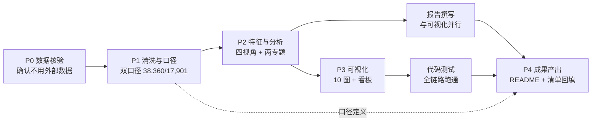

# 任务清单 · 数说奥运 1896–2024 数据分析

> 本文档为**规划与调度**文件，不含代码实现细节。随任务推进逐项更新状态。
> 状态图例：`待办` / `进行中` / `已完成` / `阻塞`

## 〇、总体目标

对 `olympics_dataset.csv`（252,565 行 × 11 列，1896–2024 夏季奥运会）完成一次完整的数据分析链路：
**数据体检与口径定义 → 清洗归一 → 特征工程与探索分析 → 可视化 → 报告与代码仓库**。

### 验收标准（对齐赛题评分表）

| 维度 | 分值 | 本项目的对应交付 | 状态 |
|---|---|---|---|
| A 数据处理与口径严谨性 | 25 | 《数据质量与口径说明书》+ 可复现清洗脚本 | 已完成 |
| B 可视化设计 | 25 | 10 张静态图 + 交互看板，每幅附口径声明 | 已完成 |
| C 分析深度与洞察 | 25 | 分析报告，含机制解释与反直觉结论 | 已完成 |
| D 叙事与呈现 | 15 | Markdown 报告 + README + 图表索引 | 已完成 |
| E 创新性 | 10 | 双口径对比贯穿全篇；东道主「守恒而非诅咒」的重述 | 已完成 |
| F 加分项 | +10 | 交互式 HTML 看板（7 个图表容器） | 已完成 |

### 使用者偏好约束

- 语言：Python
- 文档格式：Markdown
- 代码注释覆盖：语义、调用方信息、数据流关系（本项目单进程串行，各模块已注明调用链）
- 图表布局：横向（LR）；示意图从简
- 交付物：过程精简 + 最终完整报告

---

## 一、任务分解与最终状态

### 阶段 P0 · 数据采集与核验　✅ 全部完成

| ID | 任务 | 状态 | 产出 | 验收 |
|---|---|---|---|---|
| P0-1 | 确认本地数据集可用 | 已完成 | `docs/data_profile.md` | 252,565 行 × 11 列，UTF-8 无 BOM ✅ |
| P0-2 | 向用户确认是否需要补充外部数据 | 已完成 | 用户决策：**不补充外部数据** | 已获明确答复 ✅ |
| P0-3 | （可选）采集外部数据 | 已完成（跳过） | 无 | 按用户决策不执行 ✅ |

说明：本地已有赛题数据集，按约定不默认联网抓取，先询问用户是否需要扩展数据源。

---

### 阶段 P1 · 数据清洗与存储　✅ 全部完成

| ID | 任务 | 状态 | 产出 | 验收结果 |
|---|---|---|---|---|
| P1-1 | 六类已知质量问题逐项体检 | 已完成 | `quality_checks.py` + `outputs/tables/quality_checks.md` | QC1–QC6 全部跑通，每项含方法/数值/结论 ✅ |
| P1-2 | 奖牌双口径定义与实现 | 已完成 | 行口径 38,360 / 小项口径 17,901 | 收缩 53.3%，两表并存 ✅（本口径 2024 USA 金牌 37，官方 40，偏差已声明） |
| P1-3 | Sport 大类归一映射表 | 已完成 | `docs/Task1/sport_mapping.csv` | 76 → 57 类，归一后零空值 ✅ |
| P1-4 | Event 泛化处理策略落地 | 已完成 | `event_is_generic` + `event_resolved` | 策略 S2 保留下沉，实测 6,488 行 / 21.62% ✅ |
| P1-5 | 特殊记录处理 | 已完成 | `is_official` / `noc_lineage` 字段 | 1906 标记 1,733 行与原始一致 ✅ |
| P1-6 | 缺失/异常/重复检查与归一化 | 已完成 | 主表 252,565 × 19 | 无静默丢行 ✅ |
| P1-7 | 清洗结果校验 | 已完成 | `docs/Task1/cleaning_verification.md` | 行数守恒 + 抽样 200 行一致 ✅ |
| P1-8 | 清洗/归一数据集落盘 | 已完成 | `docs/Task1/*.csv`（4 个数据表 + 2 个映射表） | 由 `backend/src/cleaning.py`、`features.py` 生成 ✅ |

---

### 阶段 P2 · 特征工程与分析　✅ 全部完成

| ID | 任务 | 状态 | 产出 | 验收结果 |
|---|---|---|---|---|
| P2-1 | 派生特征 | 已完成 | `features_noc_year.csv`（3,201 行） | 含 medal_per_athlete、gold_share、is_host、delta 等 ✅ |
| P2-2 | 视角 A · 奖牌格局 | 已完成 | `a_*.csv` + 报告第二节 | 双口径对照 + 3.46 倍膨胀 ✅ |
| P2-3 | 视角 B · 国家兴衰 | 已完成 | `b_*.csv` + 报告第三节 | 10 国曲线，覆盖 US/URS/GDR/GER/CHN/JPN/GBR/AUS/FRA/KOR ✅ |
| P2-4 | 视角 C · 女性奥运弧线 | 已完成 | `c_*.csv` + 报告第四节 | 0% → 49.1% 可复现，三次阶跃定位 ✅ |
| P2-5 | 视角 D · 项目演化 | 已完成 | `d_*.csv` + 报告第五节 | 拔河、艺术竞赛、滑板、霹雳舞均有落点 ✅ |
| P2-6 | 专题深挖 | 已完成 | `s1_*.csv`、`s2_*.csv` + 报告第六七节 | S2 口径的魔力 + S1 东道主效应，均含机制解释 ✅ |
| P2-7 | 反直觉发现与交叉验证 | 已完成 | 报告第八节，5 条洞察 | 每条标注证据强度与反例 ✅ |

---

### 阶段 P3 · 数据可视化　✅ 全部完成

| ID | 任务 | 状态 | 产出 | 验收结果 |
|---|---|---|---|---|
| P3-1 | 可视化方案设计 | 已完成 | 图表清单（见报告第十节） | 每图对应一个论点 ✅ |
| P3-2 | 静态图产出 | 已完成 | `figures/fig01–fig10.svg` | 10 张，全部合法 XML，含口径脚注 ✅ |
| P3-3 | 交互式 Dashboard | 已完成 | `dashboard.html` | 单文件自包含，7 个图表容器 + 5 个 KPI ✅ |
| P3-4 | 代码测试（全链路一键跑通） | 已完成 | `backend/src/run_all.py` + `docs/test_log.md` | 从原始 CSV 到全部图表 5.5 秒、EXIT=0、幂等 ✅ |

---

### 阶段 P4 · 成果产出　✅ 全部完成

| ID | 任务 | 状态 | 产出 | 验收结果 |
|---|---|---|---|---|
| P4-1 | 数据质量与口径说明书 | 已完成 | `docs/Task1/数据质量与口径说明书.md` | 覆盖 Q1–Q6 全部规则 + 六项检查实测值 ✅ |
| P4-2 | 数据分析报告 | 已完成 | `docs/03_分析报告.md`（311 行） | 摘要 + 四视角 + 两专题 + 5 条洞察 + 局限 ✅ |
| P4-3 | README | 已完成 | `README.md` | 环境、运行步骤、目录结构、口径说明齐全 ✅ |
| P4-4 | 任务清单状态回填 | 已完成 | 本文档 | 与实际产物一致 ✅ |

---

## 二、依赖关系（实际执行路径）

文字版：清洗与口径是唯一上游瓶颈；四视角分析与专题可并行；报告撰写与可视化并行；测试依赖可视化完成；README 依赖测试记录。

---

## 三、关键假设与实际发生情况

| # | 假设/风险 | 实际结果 | 处置 |
|---|---|---|---|
| R1 | 不引入外部数据也能成立 | ✅ 成立，全部结论仅由赛题数据集支撑 | 已按用户决策执行 |
| R2 | 运动员个体粒度不可靠（Q4） | ✅ 确认：498 个姓名跨度超 50 年 | 主结论全部落在「代表团 × 届次」层级 |
| R3 | Event 泛化导致小项数统计不一致 | ✅ 实测 21.62% | 策略 S2，相关图表加脚注 |
| R4 | 双口径数字与官方差异大 | ✅ 2024 CHN 38 / USA 37 vs 官方 40 / 40 | 凡与官方对比处强制标注口径 |
| R5 | 赛题文档数字与实测偏差 | ✅ 发现 3 处（player_id 频次 1.07 vs 1.1、QC3 的 163 vs 34、QC5 的 21.62% vs 22–23%） | 报告一律以实测为准并说明差异原因 |

### 执行中的三次修正（记录在案）

1. **洞察 1 方向写反**：初版称「近 76 年主导因素是小项扩张」，而实测 1948→2024
   代表团 ×3.49 > 小项 ×1.89。复核后改为分阶段表述：**早期靠代表团扩张，近 76 年靠小项扩张**
   （其中小项扩张是三项里最慢的，报告已据此改写措辞）。
2. **洞察 5 稀释问题**：初版用奖牌绝对总额计算前三名份额，会被小项扩张稀释（得 5.1%）；
   改为逐届计算当届内部份额后取均值，修正为 **27.0%**。
3. **图表索引与实际产物不符**：初稿索引图名是按计划预设的，与最终 `figures/` 下实际生成的
   10 张图不一致，已按实际文件名与图名全部重写。

---

## 四、交付物清单

| 类型 | 文件 |
|---|---|
| 代码 | `backend/src/run_all.py`、`quality_checks.py`、`cleaning.py`、`features.py`、`visualize.py` |
| 文档 | `README.md`、`docs/01_任务清单.md`、`02_数据质量与口径说明书.md`、`03_分析报告.md`、`data_profile.md`、`cleaning_verification.md`、`test_log.md` |
| 图表 | `figures/fig01`–`fig10`.svg、`dashboard.html` |
| 数据产物 | `docs/Task1/*.csv`（6 个，含数据集与映射表）、`outputs/tables/*`（17 个） |

---

## 五、变更记录

| 阶段 | 变更 |
|---|---|
| 初版 | 建立完整任务分解表，状态全部置为待办 |
| 数据采集后 | P0 全部关闭；用户确认不引入外部数据 |
| 清洗完成后 | P1 全部关闭；双口径实测 38,360 / 17,901 |
| 分析完成后 | P2 全部关闭；洞察 1 与洞察 5 经复核修正 |
| 测试完成后 | P3 全部关闭；修复 itertuples 取列的两处 TypeError |
| 最终 | P4 全部关闭；图表索引与 README 与实际产物对齐 |
