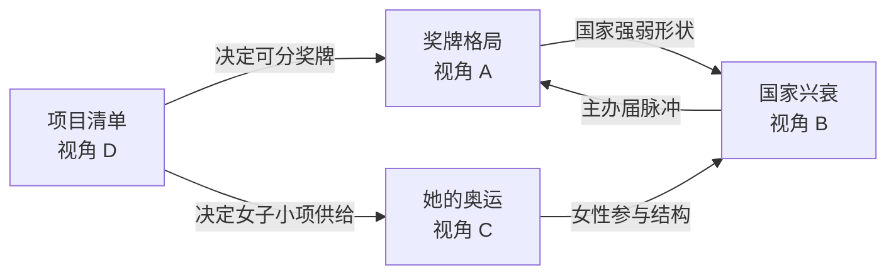

# 四视角详细解读：从奖牌榜到项目清单

> 对应任务：任务二 · 四视角探索分析
> 对应页面：`/medals`（奖牌格局）、`/countries`（国家兴衰）、`/gender`（她的奥运）、`/sports`（项目演化）
> 数据基座：`backend/api/data/dashboard.json`，由 `backend/api/build_data.py` 从原始 CSV 与 `outputs/tables/` 生成
> 口径基线：《数据质量与口径说明书》（`docs/Task1/数据质量与口径说明书.md`）

---

## 0. 读之前必须统一的四件事

### 0.1 一行数据是什么

原始数据的真实粒度是：**一名运动员 × 一届奥运会 × 一个小项**。团体项目里每位成员各占一行，接力项目每一棒各占一行。因此“奖牌行数”不等于“奖牌枚数”，这是四个视角所有分歧的起点。

### 0.2 两套奖牌口径

| 口径 | 计数方式 | 总量 | 适合回答 |
|---|---|---|---|
| 运动员行口径 | 每条奖牌记录计 1 枚 | **38,360** | 多少人次登上领奖台、女性参与、团体依赖度 |
| 小项口径 | 去重键 `(Year, Event, Medal, NOC)` | **17,901** | 奖牌榜、跨国比较、国家实力 |

两者相差 **53.3%**。这个比例不是误差，而是“团体项目复制行”的规模。任何跨页对比都必须先看当前口径。

### 0.3 时间口径

- 默认排除 **1906 届间奥运会**；该届有 458 行奖牌记录，全量行口径为 38,818。
- 2020 东京实际举办于 2021 年，数据记为 2020，不做改写。
- 1956 年马术分场在斯德哥尔摩，城市保留原值，不合并。

### 0.4 2020/2024 的小项泛化

这两届共 30,013 行，其中 **6,488 行（21.62%）** 的 `Event` 是 `Men`、`Women`、`Men Team`、`Relay Only Athlete` 等泛化值，无法还原具体小项。因此，凡是“小项数量”类指标，在这两届只能降维到“运动大类 × 性别”粒度，不能与前届直接相接。

### 0.5 三个容易混淆的统计层级

| 层级 | 字段 | 数量 | 说明 |
|---|---|---|---|
| 国家 / 地区 | `NOC` | 233 | 奖牌榜的默认比较单位 |
| 团队 | `Team` | 1,211 | 含 `China-1` 这类分队与帆船船名，不能等同于“代表团实力” |
| 届次 | `Year` | 30 | 官方届次，另含 1906 |

> **关键提醒**：团队数（Team）和国家数（NOC）不是一回事。法国有 155 个 Team 取值，很大一部分来自帆船项目的船名，而不是 155 个体育代表团。

---

## 1. 视角 A · 奖牌格局：全勤王、短跑冠军与迟到者

### 1.1 这个视角回答什么

不是“谁最强”，而是：**在同一套计数规则下，历史总榜长什么样，为什么长成这样。**

### 1.2 页面结构

| 区块 | 图表 / 组件 | 读法 |
|---|---|---|
| KPI | 区间奖牌、金牌、夺牌代表团、平均放大倍数 | 随左侧口径与年份区间变化 |
| 逐届奖牌构成 | 金/银/铜堆叠柱 | 点击某届，全站联动到该届 |
| 区间总榜前 12 | 横向条形 | 按当前口径总奖牌排序，点击国家联动 |
| 历史总榜明细 | 可排序、分页表格 | 含金/银/铜、合计、放大倍数、参赛记录 |
| 重点国家逐届轨迹 | 多国折线 | 未选国家时默认总榜前 5 |

### 1.3 历史总榜（小项口径，排除 1906）

| # | NOC | 金 | 银 | 铜 | 合计 |
|---|---|---|---|---|---|
| 1 | USA | 1,095 | 880 | 773 | **2,748** |
| 2 | URS | 394 | 317 | 294 | **1,005** |
| 3 | GBR | 305 | 347 | 343 | **995** |
| 4 | CHN | 302 | 218 | 195 | **715** |
| 5 | GER | 250 | 276 | 302 | **828** |
| 6 | FRA | 240 | 279 | 299 | **818** |
| 7 | ITA | 234 | 206 | 228 | **668** |
| 8 | JPN | 189 | 160 | 190 | **539** |
| 9 | HUN | 188 | 163 | 181 | **532** |
| 10 | AUS | 181 | 192 | 227 | **600** |

注意表格按**金牌**排序，所以 CHN（715）排在 GER（828）之前。这是奖牌榜的常见规则，但会让“总奖牌更多”的国家排在后面，读表时必须先确认排序键。

### 1.4 三种曲线形状，比名次更有信息量

**长平台型（USA、GBR）**：两国都参加了 30 届，把 1896–2024 全程铺满。USA 拿 2,748 枚，GBR 拿 995 枚，靠的是“又强又久”。GBR 的单届峰值出现在 1908 年（143 枚），此后长期低位，说明早期东道主与项目定义权能带来远超长期实力的单届份额。

**尖峰型（URS）**：苏联只参加 9 届就拿到 1,005 枚，用三分之一的参赛窗口进入千枚俱乐部。它的总量不是时间积累，而是单届密度；实体消失后曲线直接折断。

**追赶型（CHN、JPN）**：CHN 15 届拿 715 枚，2008 年单届 100 枚；JPN 24 届拿 539 枚，单届峰值恰好是自己的主办届 2020 年（57 枚）。两者都叫“单届最高”，但 CHN 更像结构性增长，JPN 带有明显的主办脉冲。

### 1.5 金银铜结构也是结论

- GBR（305/347/343）、FRA（240/279/299）、AUS（181/192/227）：银铜多于金，属于“参赛面广、决赛转化率一般”的形状。
- CHN（302/218/195）：金牌占比明显更高，属于“窄口径、高强度”的形状。
- 小项口径三色总量为金 5,816 / 银 5,783 / 铜 6,302，铜最多；与“并列第三多发铜牌、早期部分小项不发铜牌”两个方向相互抵消后的净结果一致。

### 1.6 奖牌膨胀慢于参赛面扩张

2024 年小项口径总奖牌是 1896 年的 **3.46 倍**，而参赛代表团数是 **6.65 倍**。可分的东西涨得慢，来分的人涨得快，所以单届“人均可分奖牌”持续下降，早期“少数国家分掉大半奖牌”的结构不可能自动维持。

### 1.7 常见误读

- 把行口径当官方奖牌榜：USA 2024 年金牌会从 37 变成 131。
- 只看总榜不看参赛届数：总榜天然偏袒“参赛届数多”的实体。
- 把 GER 的 828 枚理解为“德国 30 届累计”：1980 年代那批奖牌记在 GDR 名下，不在 GER 行内。

---

## 2. 视角 B · 国家兴衰：三种形状与一张热力图

### 2.1 这个视角回答什么

同一个国家在 128 年里是持续强、突然强、还是刚刚开始强？以及，**主办届到底给东道主带来了什么**。

### 2.2 页面结构

| 顺序 | 区块 | 作用 |
|---|---|---|
| 1 | 国家档案表 | 先给结论：排名、奖牌、金牌、放大倍数、首末届、区间最佳、主办届 |
| 2 | 重点国家逐届曲线 | 看形状；红色菱形标出主办届 |
| 3 | 国家 × 届次热力图 | 看密度；颜色越深奖牌越多，空白代表未参加或未获奖 |

### 2.3 三种国家形状

**长平台型（USA、GBR）**：30 届全勤，曲线是长平台。GBR 的峰值在 1908 年，USA 的峰值更多出现在现代，但两者共同点是“几乎每一届都在”。

**尖峰型（URS，以及分立期的 GDR）**：届数少、密度高。URS 9 届 1,005 枚；GDR 只参加 5 届就留下 843 行奖牌记录，是“效率奇迹”，但代价是实体消失后曲线折断。

**追赶型（CHN、JPN）**：CHN 1932 年首现，2008 年单届 100 枚；JPN 1912 年首现，2020 年单届 57 枚。前者是布局铺开，后者是主办脉冲。

### 2.4 主办菱形怎么读

折线图上的红色菱形表示“该国在这一届是东道主”，尺寸比普通数据点更大，并带白色描边。

- 菱形**只说明身份**，不说明因果；它落在曲线的高点还是低点，需要和前后届对比。
- 多数东道主的菱形出现在局部峰值附近，但 1996 USA、2016 BRA 是例外：主办届增长很小，赛后也没有明显回落。
- 更准确的说法是：**主场红利越是被兑现得彻底，赛后回落越不可避免**——是守恒，不是诅咒。

### 2.5 热力图怎么读

- 纵轴是所选国家，横轴是届次。
- 颜色按**当前区间内的最大奖牌数**归一化，所以切换年份区间后，同一格的颜色会变深或变浅。
- 空白格不是 0 奖牌的另一种颜色，而是“该国在该届没有记录”：可能没参赛，也可能参赛但未获奖。
- 点击任意格子，会把“届次 + 国家”同时写入全站联动。

### 2.6 边界与注意

- 国家排名一律使用原始 `NOC`，不把 URS 并入 RUS、不把 GDR 并入 GER；政体继承链只用于长周期叙事。
- 热力图颜色是相对值，不同区间之间不能直接比色深。
- 2024 年赛后数据缺失，东道主回落无法计算，不做预测。

---

## 3. 视角 C · 她的奥运：三级台阶，而不是一条斜坡

### 3.1 这个视角回答什么

女性从 0% 走到约一半，走的是连续进步，还是名单级扩容？供给端（女子小项）和需求端（女性参赛）谁先动？

### 3.2 页面结构

| 顺序 | 区块 | 作用 |
|---|---|---|
| 1 | 各代表团女性参赛明细表 | 先给明细：参赛记录、女性记录、女性占比 |
| 2 | 百年弧线 | 随左侧口径切换指标 |
| 3 | 女子小项供给 | 柱为小项数，线为女子小项占比 |
| 4 | 各国女性参赛占比饼图 | 默认按左侧年份区间汇总，也可切到单届 |

### 3.3 两个指标必须分清

| 口径 | 指标 | 定义 | 2024 年值 |
|---|---|---|---|
| 运动员行口径 | 女性参赛占比 | 女性参赛记录 ÷ 全部参赛记录 | **49.1%** |
| 小项口径 | 女性奖牌占比 | 女性小项奖牌 ÷ 全部小项奖牌 | **49.4%** |

两者接近但不相等，不能互相替代。前者回答“有多少女性站上赛场”，后者回答“奖牌有多少落在女子项目”。差异来自团体项目、各国女子项目结构与奖牌分布。

### 3.4 关键节点

| 指标 | 数值 |
|---|---|
| 1896 年女性参赛占比 | 0% |
| 女性首次出现 | 1900 年 |
| 女性首次夺牌 | 1900 年（USA 5、GBR 2、SUI 2，行口径） |
| 女性占比首次达到 45% | 2012 年 |
| 2024 年女性参赛占比 | 49.1% |
| 2024 年女子小项占比 | 44.56% |

### 3.5 三次阶跃

按运动员行口径，最大三次跃升是：

| 届次 | 跃升 |
|---|---|
| 1952 | **+8.3pp** |
| 1996 | **+4.6pp** |
| 1976 | **+3.9pp** |

三次合计 16.8pp，而全程增长 49.1pp，也就是说约三分之一的进程压缩在三个单届里。女性入场更像“某一届一次性开放一批女子小项，或一批女子队伍首次成建制参赛”，跳一个台阶，然后进入平台期。

> 注意：切到小项口径后，弧线指标变成“女性奖牌占比”，阶跃标注会随之变化（实测为 1952 +2.7pp、1976 +1.0pp、1996 +4.6pp）。两套标注不能混用。

### 3.6 供给端：女子小项先增，参赛占比后跟

女子小项供给图的读法是“先看柱、再看线”：

- 浅色柱是全部小项，深色柱是女子小项，线是女子小项占比。
- 供给先于参与变化：某一届女子小项数增加，随后才有女性参赛记录的增长。
- 2020/2024 受 `Event` 泛化影响，女子小项计数偏低，只能看趋势，不能精确比较。

### 3.7 国别结构

全期女性参赛记录共 **74,010 条**（运动员行口径，`records` 而非唯一人数）。占比最高的国家/地区：

| NOC | 代表团 | 女性参赛记录 | 占全部女性记录 |
|---|---|---|---|
| USA | United States | 5,146 | 7.0% |
| GBR | Great Britain | 3,469 | 4.7% |
| AUS | Australia | 3,285 | 4.4% |
| CAN | Canada | 3,106 | 4.2% |
| CHN | China | 3,000 | 4.1% |
| FRA | France | 2,804 | 3.8% |
| JPN | Japan | 2,732 | 3.7% |
| GER | Germany | 2,729 | 3.7% |

饼图默认按左侧区间汇总，也可以在右侧切到单届。切换饼图范围不会反向修改左侧全局区间；左侧区间变化时，饼图会自动回到「区间汇总」。

### 3.8 为什么 2024 停在 49.1%

2012 年才首次达到 45%，到 2024 年用了 12 年只前进了约 4pp。容易开放的、成本低的项目先开完了，剩下的是赛程结构、参赛名额、训练体系上的硬约束。名义名额平等与实际报名结构不是同一件事。

### 3.9 常见误读

- 用行口径的女性占比去解释奖牌榜：两者口径不同。
- 把 49.1% 当成“已经接近一半”：这是参赛记录占比，不是唯一运动员人数占比。
- 把 2020/2024 的女子小项数直接与前届比较：泛化命名会让计数偏低。

---

## 4. 视角 D · 项目演化：57 个门类里，21 个已经关门

### 4.1 这个视角回答什么

哪些项目活得久、哪些只办一届、哪些“名亡实存”？新增项目的逻辑与退场项目的逻辑是否相同？

### 4.2 页面结构

| 顺序 | 区块 | 作用 |
|---|---|---|
| 1 | 运动明细表 | 先给全量：首次、末次、届数、记录数、跨度、状态 |
| 2 | 运动竞赛记录量动态排名 | 逐年排序前 12，可播放、暂停、循环、调节间隔、指定年份 |
| 3 | 小项数量与泛化占比 | 折线为小项数，红柱为泛化行占比 |

### 4.3 动态排名怎么读

- 排序指标是**当年竞赛记录量**（`sportYear.records`），不是奖牌数。
- 只展示前 12 名，条形长度与名次会随年份变化，动画会保留上一帧的位置做过渡。
- 点击条形可选中运动，红色高亮会同步到明细表；再点一次取消。
- 播放间隔可在 200–2000 ms 之间调整，数值越小推进越快；播放中调整立即生效。

两个时间切片对比：

| 1896 前五 | 记录数 | 2024 前五 | 记录数 |
|---|---|---|---|
| Athletics | 106 | Athletics | 2,352 |
| Gymnastics | 97 | Swimming | 1,677 |
| Shooting | 65 | Gymnastics | 1,362 |
| Cycling | 41 | Cycling | 881 |
| Tennis | 23 | Judo | 559 |

榜单头部很稳定（田径、游泳、体操、自行车），但**同一位置的量级变化很大**：田径从 106 涨到 2,352，游泳从 18（1896 年第六）涨到 1,677 并升到第二。这说明“项目演化”不是简单的项目替换，更多是同一批核心项目的规模扩张，加上少量新项目入场。

### 4.4 三类“消失”，只有一类是真退场

已退场 21 项，但必须拆开看：

| 类型 | 例子 | 实际情况 |
|---|---|---|
| 夏季办过的冰雪项目 | Figure Skating（1908–1920）、Ice Hockey（1920） | 在后来的冬奥会里继续存在，只是不再出现在夏季赛程 |
| 改名或变体回归 | Baseball（1992–2008）→ Baseball/Softball（2020）；Rugby（1900–1924）→ Rugby Sevens（2016） | 项目没死，名字或赛制变了 |
| 归类口径造成 | Trampolining（2000–2016） | 与体育大类归并规则有关，属于统计口径事件 |
| 真正永久退场 | Croquet、Roque、Racquets、Jeu De Paume、Basque Pelota、Motorboating、Cricket | 器材贵、场地专属、参赛国极少，记录数只有个位数到二十几 |

体量最大的“消失项目”是 **Art Competitions（1912–1948，3,578 条记录）**，第二名 Baseball 只有 894 条。它也是唯一一个参赛主体不是运动员的大类（建筑、文学、音乐、绘画、雕塑）。

### 4.5 入口端与出口端逻辑相反

最新入场的是 Breaking 2024（33 条）、Skateboarding 2020（168）、Sport Climbing 2020（108）、Surfing 2020（88）、Karate 2020（81）、Baseball/Softball 2020（234）、Rugby Sevens 2016（928）。

出口端看“能不能被更多国家低成本复制”；入口端看“年轻观众与城市景观”。Karate 只办一届就出局，说明“入奥”和“留下”是两个独立的筛选机制。这是四个视角里最接近“项目清单被当作媒体产品运营”的一条观察。

### 4.6 泛化对项目计数的影响

2020/2024 的 `Event` 泛化比例为 21.62%，所以：

- “小项数量”折线在 2020 处不连续，不能与前届直接比较。
- 动态排名用的是“运动大类的竞赛记录量”，不受 Event 泛化影响，可以跨全程比较。
- 女子小项供给图同样受泛化影响，只能看趋势。

### 4.7 常见误读

- 把“记录数”当奖牌数：记录数是原始行数，包含未获奖的参赛记录。
- 把“已退场”理解成永久消失：至少三类是名亡实存。
- 用 2024 年小项数直接对比 2016 年：泛化命名会让 2024 年偏低。

---

## 5. 四个视角怎么串起来

- **视角 D 是上游**：项目清单决定奖牌总量、女子小项供给与哪些国家能拿牌。
- **视角 A 是结果**：同一批项目在不同口径下给出两套奖牌榜。
- **视角 B 是形状**：把总榜拆成逐届曲线，才能看到平台、尖峰与追赶。
- **视角 C 是结构**：女性入场不是自然增长，而是供给端开放后的台阶式变化。

五条跨视角结论：

1. 规模扩张在两个阶段由不同因素主导：1948 年前靠代表团扩张，1948 年后靠小项扩张。
2. 团体项目依赖度不随国家变大而升高：大国奖牌面宽，小国更容易被单一团体项目拉高放大倍数。
3. 女性占比呈阶跃而非匀速：三次跃升合计 16.8pp，约占全程增长的三分之一。
4. 东道主效应是一次性脉冲：29 位可比东道主中 26 位赛后下降，平均回落 −29.2 枚。
5. 奖牌集中度大幅下降：1912 年前前三名平均占当届 68.6%，2000 年后降至 27.0%。

---

## 6. 一页速查

| 视角 | 核心问题 | 主图 | 口径 | 一句话结论 | 最大的坑 |
|---|---|---|---|---|---|
| 奖牌格局 | 谁在历史上拿得最多 | 逐届构成 + 总榜前 12 + 明细表 | 双口径可切 | USA 全勤、URS 尖峰、CHN 追赶 | 把行口径当官方榜 |
| 国家兴衰 | 强国是什么形状 | 逐届曲线 + 热力图 | 小项口径为主 | 平台、尖峰、追赶三种形状 | 热力图颜色是相对值 |
| 她的奥运 | 女性如何进入奥运 | 弧线 + 供给 + 饼图 | 弧线随口径切换 | 三级台阶，不是斜坡 | 参与占比 ≠ 奖牌占比 |
| 项目演化 | 项目为何生死 | 动态排名 + 泛化图 | 记录量，非奖牌 | 出口看可复制，入口看观赏性 | 记录数 ≠ 奖牌数 |

---

## 7. 数据与代码索引

| 类型 | 路径 |
|---|---|
| 前端页面 | `frontend/datavision/src/views/MedalsView.vue`、`CountriesView.vue`、`GenderView.vue`、`SportsView.vue` |
| 全局状态 | `frontend/datavision/src/stores/dashboard.js` |
| 数据生成 | `backend/api/build_data.py` → `backend/api/data/dashboard.json` |
| 奖牌明细 | `outputs/tables/a_history_medal_table.csv` |
| 国家指标 | `outputs/tables/b_focus_countries.csv` |
| 性别序列 | `outputs/tables/c_gender_by_year.csv`、`c_women_event_supply.csv` |
| 运动生命周期 | `outputs/tables/d_sport_lifecycle.csv` |
| 双口径专题 | `outputs/tables/s2_2024_caliber_compare.csv`、`s2_caliber_rank_shift.csv` |
| 东道主专题 | `outputs/tables/s1_host_effect.csv` |

> 所有涉及 2020/2024 “小项数量”的图表均需加泛化脚注；所有涉及 1906 的数字需注明“含 1906”。
