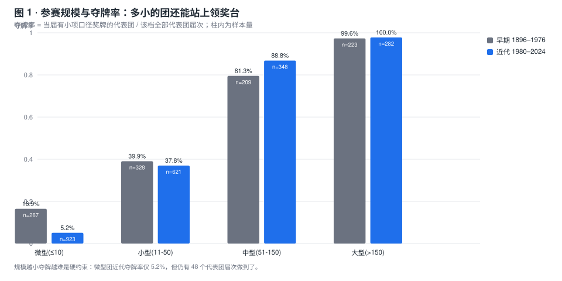
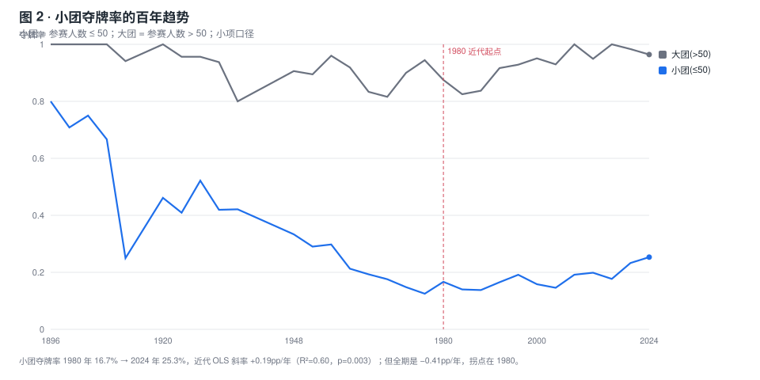
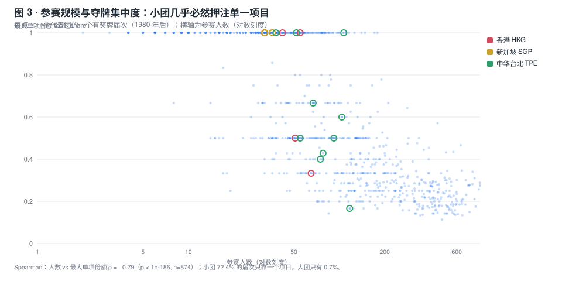
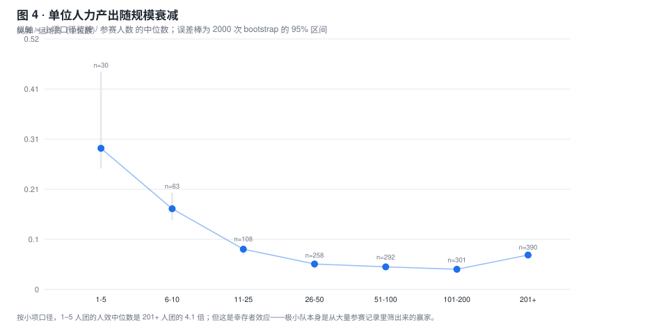
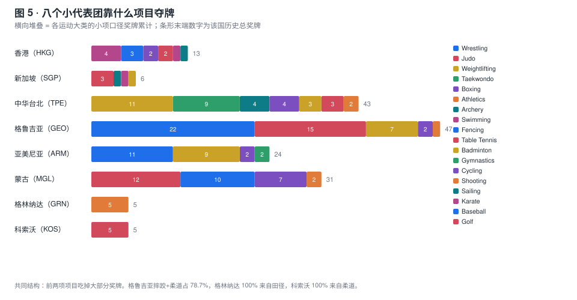
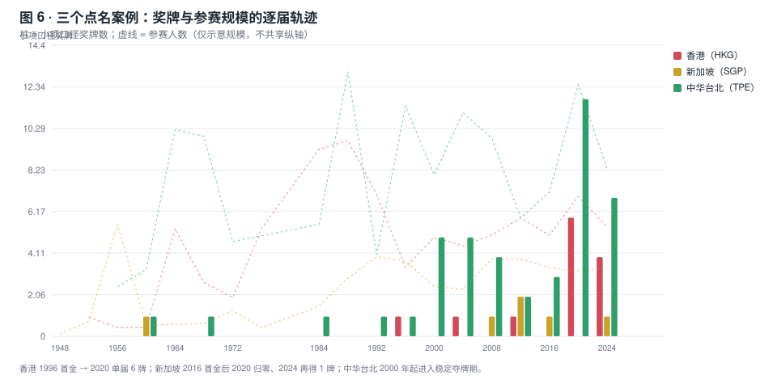
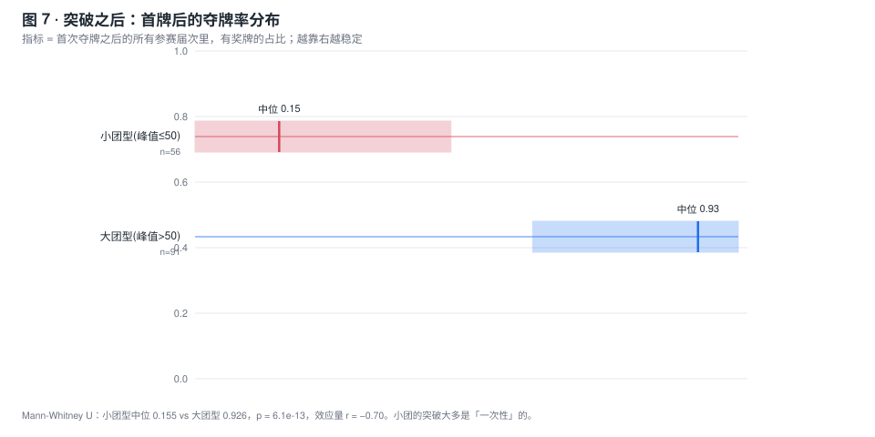
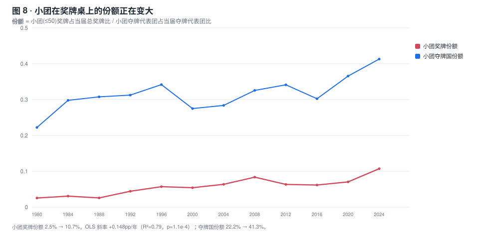
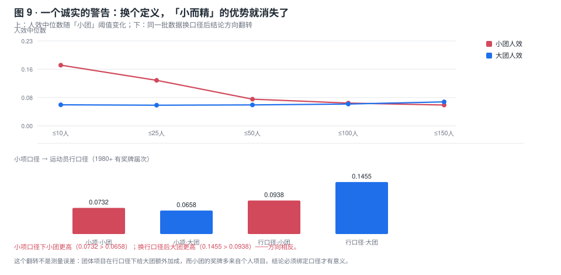

# 小代表团的大突破：规模约束下的夺牌机制、可持续性与口径边界

**专题**：Task3 · S4（中国香港 / 中华台北 / 新加坡等「小而精」夺牌策略）
**数据**：项目数据集 `olympics_dataset.csv`（252,565 行 × 11 列，1896–2024 夏季奥运会），经 Task1 清洗
**主口径**：小项口径（17,901 枚）；对照口径：运动员行口径（38,360 枚）；默认排除 1906 届
**全部定量结论可由** `python backend/src/task3_s4_run_all.py` 一键复现

---

## 摘要

小代表团拿牌不是靠「更努力」，而是靠**结构性收缩**。近代（1980+）微型团（≤10 人）夺牌率只有 5.20%，但仍有 48 个微型团届次站上领奖台；极端处，30 个「参赛≤5 人」的届次拿到奖牌。机制近乎必然：小团 72.44% 的夺牌届次中，全部奖牌来自同一个运动大类，大团只有 0.71%；参赛人数与最大单项份额的 Spearman ρ = −0.7903。单位人力产出随规模缩小而升高（1–5 人团人效中位 0.2917，为 201+ 人团的 4.1 倍），但这是**幸存者效应**，且换口径即翻转。突破极难持续：小团型国家首牌后夺牌率中位仅 0.1548，大团型为 0.9259；19.11% 的曾夺牌国只在一届拿过牌。结构上，小团奖牌份额从 1980 年 2.54% 升至 2024 年 10.72%，而小团占参赛国比例基本未变——上升的是产出，不是数量。

---

## 一、问题与口径

**本节结论：三个研究问题都能用同一套数据回答，但答案对「口径」和「时代断点」高度敏感，必须先把这两件事钉死，否则后面每一节都会读出相反的结果。**

### 1.1 研究问题

赛题 S4 的原话是：「中国香港（HKG）：1996 年首金 → 2020 年 8 行奖牌的历史最佳 → 2024；以及 TPE、SGP 等『小而精』的夺牌策略（聚焦个别优势项目 vs 全面上阵）」。

由此拆出三个可检验的问题：

| 编号 | 问题 | 对应章节 | 判定指标 |
|---|---|---|---|
| Q1 | 参赛规模很小的代表团，靠什么取得超出体量的突破？ | 二、三、四 | 夺牌率、集中度、人效 |
| Q2 | 突破口是「集中押注少数优势项目」还是「全面铺开」？ | 三、五 | top1_share、HHI、夺牌大类数 |
| Q3 | 这种突破能否持续？ | 六、七 | 首牌后夺牌率、最长连续届数、一次性突破国占比 |

### 1.2 一个必须先纠正的口径差异

赛题说 HKG「2020 年 8 行奖牌」——那是**运动员行口径**。本项目主口径是小项口径，实测 HKG 2020 年为 **6 枚**（行口径才是 8 行）。同一届、同一批成绩，两个数字差 2，差额来自团体项目：乒乓女团等项目的多名运动员各自占一行，去重键 `(Year, Event, Medal, NOC)` 把它们收成 1 枚。

**这个差异容易被误读为「数据不一致」，实际上是 Task1 口径工作的价值所在**：只有把小项口径显式定义并去重，跨国家、跨届次的横向比较才成立；行口径适合度量「多少人次登上领奖台」，不适合数奖牌。本报告所有奖牌数除特别标注外，均为小项口径。

### 1.3 双口径与总量守恒

| 口径 | 定义 | 总量 | 用途 |
|---|---|---|---|
| 小项口径（主） | 去重键 `Year, Event, Medal, NOC` 各计 1 枚 | **17,901** | 奖牌榜对齐、横向比较 |
| 运动员行口径（对照） | 每个奖牌运动员行计 1 枚 | **38,360** | 人次、团体项目放大效应 |

两口径收缩 53.3%，即超过一半的奖牌行是团体项目成员的复制行。行级校验中「小项口径 ≤ 行口径」的越界差异为 0，说明小项口径确为行口径的去重子集，无静默丢行。

### 1.4 「小代表团」的操作定义

不用奖牌数定义体量（那是循环论证：拿牌多所以不算小）。用**参赛人数**：

| 档位 | 参赛人数 | 角色 |
|---|---|---|
| 微型 | ≤ 10 | 极端样本 |
| 小型 | 11–50 | 赛题点名的 HKG / SGP 落在本档或以下 |
| 中型 | 51–150 | 对照 |
| 大型 | > 150 | 对照 |

主阈值取 **≤ 50**，并在第八节做 5 档敏感性（≤10 / ≤25 / ≤50 / ≤100 / ≤150），因为阈值选择本身会翻转结论。

需要区分两个易混概念：**小团届次**是单届属性（该届参赛 ≤ 50），共 2,139 个代表团届次；**小团型国家**是国家属性（历史峰值参赛 ≤ 50），共 63 个 NOC。二者样本不同，混用会得出互相矛盾的结论，本报告用到时明确标注。

### 1.5 时代断点：为什么切在 1980

早期奥运会参赛国少、设项少，夺牌率被结构性放大——1896 年只有 12 个代表团，微型团夺牌率超过 50%。把 1896 与 2024 放进同一条回归线，本质上是在比较两个不同的赛事。故**近代样本 = 1980 年及以后**（n = 12 届）。

这个选择有代价，见 2.3。

### 1.6 基础表

3,201 行（代表团 × 届次），233 个 NOC，30 个官方届次，1906 届已排除。关键总量在 `s4_verification.json` 中十项校验全部通过。

---

## 二、全景：多小的团还能拿牌

**本节结论：规模是硬约束。微型团近代夺牌率只有 5.20%，比早期的 16.85% 还低；但「几乎不可能」与「不可能」是两件事——48 个微型团届次在近代拿到了奖牌。**

### 2.1 四档规模 × 两个时代

| 规模档 | 早期届次 | 早期夺牌率 | 近代届次 | 近代夺牌率 | 全期夺牌率 | 全期奖牌数 |
|---|---|---|---|---|---|---|
| 微型(≤10) | 267 | 16.85% | 923 | **5.20%** | 7.82% | 146 |
| 小型(11-50) | 328 | 39.94% | 621 | 37.84% | 38.57% | 933 |
| 中型(51-150) | 209 | 81.34% | 348 | 88.79% | 86.00% | 2,546 |
| 大型(>150) | 223 | 99.55% | 282 | 100.00% | 99.80% | 14,276 |

（夺牌率 = 当届有小项口径奖牌的代表团数 / 该档代表团届次总数）

三点解读：

1. **微型团近代夺牌率低于早期**（5.20% < 16.85%）。这容易被误读为「小国越来越差」，实际上是**竞争密度变化**：早期只有十几个代表团，拿牌几乎不需要击败谁；近代 200 个代表团、三百多个小项，微型团要挤进前三必须打败数量级更大的对手。同一档位的绝对表现未必退步，退步的是相对位置。
2. **小型团是一个平台**（39.94% → 37.84%），几乎不随时代变化。11–50 人是「能稳定参与竞争」的最小规模区间，夺牌能力对时代不敏感——这也正是 HKG / SGP 所在的区间。
3. **大型团近代夺牌率 100%**（282 个届次无一空手）。这说明「规模 > 150」已足以保证至少一枚奖牌，奖牌榜顶端由规模决定。

### 2.2 极端案例：5 人以内

| 口径 | 届次数 | 有奖牌届次 | 占比 | 涉及 NOC |
|---|---|---|---|---|
| 参赛人数 ≤ 5 | 679 | 30 | **4.42%** | 27 个 |
| 参赛人数 ≤ 2 | 198 | 9 | 4.55% | — |

典型样本（由基础表逐行核出）：1900 CUB（2 人 2 牌，含 1 金）、1952 TTO（2 人 2 牌）、2024 LCA（5 人 2 牌 1 金）、1900 LUX（1 人 1 金）。

这 30 个「≤5 人拿牌」的届次分散在 27 个 NOC 上，意味着**这种成功几乎不重复发生**。把它们平均成一个「小团成功率高」的印象，是最常见的误读：4.42% 才是原始概率，且这 4.42% 里有相当部分来自 1900 年前后参赛门槛极低的届次。

### 2.3 趋势：先降后升，拐点在 1980

小团（≤50）夺牌率逐届序列，1980 起：

| 年份 | 1980 | 1984 | 1988 | 1992 | 1996 | 2000 | 2004 |
|---|---|---|---|---|---|---|---|
| 夺牌率 | 16.67% | 14.00% | **13.79%** | 16.53% | 19.15% | 15.83% | 14.58% |

| 年份 | 2008 | 2012 | 2016 | 2020 | 2024 |
|---|---|---|---|---|---|
| 夺牌率 | 19.18% | 19.86% | 17.69% | 23.29% | **25.33%** |

- 1980 → 2024：**+8.66 个百分点**
- 近代 OLS：斜率 **+0.1938 pp/年**，R² = **0.6047**，p = **0.002907**，n = 12
- 全期 OLS（1896–2024）：斜率 **−0.4115 pp/年**，R² = 0.6666，p = 3.78e-08，n = 30

**这是本报告最重要的陷阱之一：同一份数据，切在 1980 得到「小团在变强」，不切得到「小团在变弱」，两个结论都对。**

1950–1970 年代小团夺牌率从三成左右一路跌到 12.5%（1976），那是奥运会扩军阶段——新独立国家大批入会、多数是小团，分母暴涨而奖牌总数增长跟不上。1980 年后进入平台期并回升，原因在第七节拆解。把 1896–2024 拟合一条线，实际是「扩军效应」压过「近期改善」，斜率必然为负。

本研究选 1980 作主断点，因为 1980 年起参赛国规模稳定在 80–207 之间、设项数量级稳定，且 1980 年后的 12 届覆盖了 HKG / SGP / TPE 全部关键节点。代价明确：**用 1980 断点等于把「扩军期的结构性下降」排除在外**，任何「小团越来越强」的陈述都只在 1980 后成立。

---

## 三、机制一：近乎必然的单一项目押注

**本节结论：小团的奖牌不是「倾向于」集中，而是几乎必然集中。小团 72.44% 的夺牌届次，全部奖牌来自同一个运动大类；大团只有 0.71% 如此。**

### 3.1 小团 vs 大团的集中度对比

样本：1980+ 有奖牌的代表团届次，小团（≤50）n = 283，大团（>150）n = 282。

| 指标 | 小团中位 | 大团中位 | Mann-Whitney U | p 值 | 效应量 r |
|---|---|---|---|---|---|
| 最大单项份额 top1_share | **1.000** | 0.2601 | 77,735 | 4.98e-89 | +0.948 |
| 夺牌运动大类数 | **1** | 9 | 820 | 5.87e-95 | −0.980 |
| 奖牌/运动员 | 0.0732 | 0.0658 | 45,100.5 | 0.00739 | +0.130 |
| HHI | 1.000 | 0.1630 | 78,753.5 | 1.00e-93 | +0.974 |
| 当届奖牌数 | 1 | 19.5 | 1,606.5 | 2.55e-88 | −0.960 |

效应量 |r| 接近 1（大类数 r = −0.980，HHI r = +0.974），意味着这两个指标上小团与大团的分布几乎不重叠——不是「平均更集中」，是**两个几乎不交叠的群体**。中位 top1_share = 1.000 与 HHI = 1.000 是同一件事的两种写法：一枚奖牌，就是全部奖牌。

### 3.2 连续关系

Spearman 相关（1980+，n = 874）：

| 变量对 | ρ | p |
|---|---|---|
| 参赛人数 vs 最大单项份额 | **−0.7903** | 1.06e-187 |
| 参赛人数 vs 夺牌大类数 | **+0.8584** | 5.70e-255 |
| 参赛人数 vs HHI | −0.8379 | 1.49e-231 |
| 参赛人数 vs 奖牌/运动员 | −0.1096 | 0.001177 |

前三组是强相关（|ρ| > 0.79），第四组虽显著但极弱（|ρ| = 0.11）。**这个对比本身是一个结论**：规模几乎完全决定「项目面宽度」，却几乎不决定「单位人力产出」。后者的故事在第四节。

### 3.3 单项目依赖率

| 群体 | 全部奖牌来自同一大类的届次占比 |
|---|---|
| 小团（≤50） | **72.44%**（205 / 283） |
| 大团（>150） | **0.71%**（2 / 282） |
| 全体近代样本 | 32.38%（283 / 874） |

这里有一个容易被误读的数字：**全体近代样本的 32.38% 看上去像「中等水平」，实际是两个极端的加权平均**——小团贡献 283 个「几乎必然集中」的观测，大团贡献 282 个「几乎必然分散」的观测，中间派被摊薄在整体里。用全体均值描述任一组都是误导。

### 3.4 为什么必然是集中

机制上不神秘：参赛 30 人通常只能覆盖 7–11 个大类（基础表中 HKG、SGP 各届参赛大类数在 2–13 之间），其中能进世界前三的通常只有 1 个。押注不是策略选择，是**规模约束的必然产物**——「全面上阵」对小团而言不存在这个选项。Q2 的答案因此不是「集中更好」，而是「小团只有集中这一条路」。

反例存在：HKG 2020 年 65 人、6 枚、5 个大类（top1_share = 0.333），是典型的例外，详见 5.2。

---

## 四、机制二：人效与幸存者效应

**本节结论：越小的团单位人力产出越高，1–5 人团是 201+ 人团的 4.1 倍。但这个指标的分母只统计有奖牌的届次，绝大多数小团届次是 0 奖牌，被排除在外。**

### 4.1 人效曲线

按参赛人数分箱的「小项口径奖牌 / 参赛人数」中位数（2000 次 bootstrap，seed = 42）：

| 人数分箱 | 有奖牌届次 | 人效中位数 | 95% CI |
|---|---|---|---|
| 1–5 | 30 | **0.2917** | 0.2500 – 0.4500 |
| 6–10 | 63 | 0.1667 | 0.1429 – 0.2000 |
| 11–25 | 108 | 0.0833 | 0.0718 – 0.0909 |
| 26–50 | 258 | 0.0526 | 0.0430 – 0.0572 |
| 51–100 | 292 | 0.0467 | 0.0415 – 0.0534 |
| 101–200 | 301 | 0.0417 | 0.0385 – 0.0476 |
| 201+ | 390 | **0.0712** | 0.0658 – 0.0739 |

两点必须同时说：

1. 1–5 人团人效中位 0.2917，是 201+ 人团（0.0712）的 **4.1 倍**。
2. **201+ 那一箱反而回升**（0.0712 > 101–200 的 0.0417）。曲线不是单调下降，是 U 形。原因是这一箱装着 USA / CHN 这类奖牌绝对量极大的超级团：分母大，分子更大（USA 历史 2,748 枚、峰值 1,109 人）。**把这条曲线读成「越小越高效」是错的，正确读法是「两端高、中间低」**——小团高在分子省，超级团高在绝对厚度，中型团两头不靠。

### 4.2 幸存者效应：为什么这个数字必然被高估

分箱的分母是「**有奖牌的届次**」，不是「全部届次」。这带来系统性偏差：

- 参赛 ≤5 人的代表团届次共 679 个，其中只有 30 个有奖牌（4.42%），其余 649 个 0 奖牌届次完全不进入人效计算。
- 小团（≤50）共 2,139 个代表团届次，进入人效计算的只有近代 283 个夺牌届次。

换句话说，**人效指标衡量的是「成功者的产出效率」，不是「一个随机小团的期望产出」**。要问「派 5 个人去奥运会值不值」，量级上应看 4.42% 这个概率，而不是 0.2917 这个人效中位。这个例子说明：**当分母被条件化时，中位数可以很干净、很显著、也很有误导性。**

### 4.3 与集中度的关系

人效与集中度是同一枚硬币的两面：小团把所有资源押在一个项目上，一旦押中，分子（1 枚奖牌）除以极小的分母（5 人）得到极高比值；一旦押不中，比值为 0 且不进入统计。第三、四节因此不是两个独立机制，而是同一机制的两个观察角度。

---

## 五、个案：八个代表团

**本节结论：八个案例共享同一结构——前两个项目吃掉大部分奖牌。区别在于「有没有第二根支柱」：HKG 在 2020 年后形成双支柱，SGP 始终单点，TPE 是唯一把项目面持续扩宽的。**

### 5.1 八个代表团的构成

| NOC | 名称 | 首赛 | 首牌 | 首金 | 参赛届数 | 夺牌届数 | 夺牌率 | 总奖牌 | 金牌 | 峰值人数 | Top 项目（奖牌数） |
|---|---|---|---|---|---|---|---|---|---|---|---|
| HKG | 香港 | 1952 | 1996 | 1996 | 18 | 5 | 27.78% | 13 | 4 | 91 | Swimming 4 / Fencing 3 / Cycling 2 / Table Tennis 2 |
| SGP | 新加坡 | 1948 | 1960 | 2016 | 18 | 5 | 27.78% | 6 | 1 | 52 | Table Tennis 3 / Sailing 1 / Swimming 1 / Weightlifting 1 |
| TPE | 中华台北 | 1956 | 1960 | 2004 | 16 | 12 | **75.00%** | 43 | 7 | 123 | Weightlifting 11 / Taekwondo 9 / Archery 4 / Boxing 4 |
| GEO | 格鲁吉亚 | 1996 | 1996 | 2004 | 8 | 8 | **100%** | 47 | 13 | 47 | Wrestling 22 / Judo 15 / Weightlifting 7 |
| ARM | 亚美尼亚 | 1996 | 1996 | 1996 | 8 | 7 | 87.50% | 24 | 2 | 38 | Wrestling 11 / Weightlifting 9 |
| MGL | 蒙古 | 1964 | 1968 | 2008 | 15 | 13 | 86.67% | 31 | 2 | 61 | Judo 12 / Wrestling 10 / Boxing 7 |
| GRN | 格林纳达 | 1984 | 2012 | 2012 | 11 | 4 | 36.36% | 5 | 1 | 9 | **Athletics 5（100%）** |
| KOS | 科索沃 | 2016 | 2016 | 2016 | 3 | 3 | 100% | 5 | 3 | 11 | **Judo 5（100%）** |

集中度实例：格鲁吉亚摔跤 + 柔道合计 37 / 47 = **78.7%**；格林纳达 100% 来自田径；科索沃 100% 来自柔道。

GEO / ARM / MGL 三国的共同点是继承了前苏联体系的格斗类项目训练传统，这是历史路径依赖，不是当期政策设计。把它们与 HKG / SGP 并列时要注意：前者的集中来自「有且只有一个传统强项」，后者的集中来自「资源只够押少数几项」，机制不同，结果相似。

### 5.2 香港：从单点偶发到双支柱

18 届参赛，5 届夺牌，13 枚，4 金。逐届明细（基础表逐行核出）：

| 届次 | 参赛人数 | 奖牌 | 项目构成 |
|---|---|---|---|
| 1996 | 32 | 1 | Sailing Women's Windsurfer（**首金**，李丽珊） |
| 2004 | 42 | 1 | Table Tennis Men's Doubles |
| 2012 | 55 | 1 | Cycling Women's Keirin（李慧诗） |
| 2020 | 65 | **6** | Cycling Women's Sprint、Fencing Men's Foil Individual（张家朗金）、Karate Women's Kata、Swimming Women's 100m Freestyle、Swimming Women's 200m Freestyle（何诗蓓两银）、Table Tennis Women's Team |
| 2024 | 51 | 4 | Fencing Men's Foil Individual（张家朗金）、Fencing Women's Épée Individual（江旻憓金）、Swimming Women's 100m / 200m Freestyle（何诗蓓两铜） |

**关键观察**：1996–2012 四届，每届只拿 1 枚，且项目每届都在换（帆船 → 乒乓 → 单车）。这不是「策略稳定」，是没有积累——每一枚都是不同项目的一次性成果，前一届的优势项目在下一届没有接续。2020 年才第一次出现多项目同时开花（6 枚、5 个大类），2024 年击剑（2 金）与游泳（2 铜）形成两个支柱。

HKG 2020 年这 6 枚是本报告「小团必然单项目」结论的**最强反例**：65 人、5 个大类、top1_share = 0.333，已不是典型单点结构。但反例存在本身说明「必然」是一个统计陈述，不是逻辑必然。

**时间线要点**：首金（1996）到单届最佳（2020）间隔 24 年，中间跨 4 届、每届 1 枚。这个节奏容易被误读为「稳步成长」，实际是 24 年的低水平平台期后突然跃升，中间没有渐变。

### 5.3 新加坡：单点突破的教科书样本

18 届参赛，5 届夺牌，6 枚，1 金。

| 届次 | 参赛人数 | 奖牌 | 项目构成 |
|---|---|---|---|
| 1960 | 5 | 1 | Weightlifting Men's Lightweight（陈浩亮银牌） |
| 2008 | 36 | 1 | Table Tennis Women's Team |
| 2012 | 36 | 2 | Table Tennis Women's Singles + Women's Team |
| 2016 | 32 | 1 | **Swimming Men's 100m Butterfly（约瑟林金，首金）** |
| 2024 | 32 | 1 | Sailing Men's Kite |

**关键观察**：SGP 的奖牌极度依赖乒乓与游泳两条线，且**2016 首金之后 2020 年归零**。18 届参赛里 5 届夺牌、13 届空手；首牌（1960）到第二次夺牌（2008）间隔 48 年——这是本报告所有持续性指标里最极端的一例，说明「曾经拿过牌」对 SGP 没有任何预测力。

乒乓球三枚奖牌全部来自归化球员体系。**这一点在外部资料可查，但数据集本身只显示国家归属、不含球员来源字段**，故在此只作标注，不作为分析依据。

### 5.4 中华台北：唯一持续扩宽项目面的案例

16 届参赛，**12 届夺牌（75%）**，43 枚，7 金。分阶段：

| 阶段 | 表现 |
|---|---|
| 1960 / 1968 | 田径各 1 枚（杨传广等） |
| 1984–1996 | 举重、棒球、乒乓各零星 1 枚 |
| 2000 起 | 进入稳定期：2000 年 5 枚（乒乓 1、跆拳道 2、举重 2 等）、2004 年 5 枚、2008 年 4 枚、2012 年 2 枚、2016 年 3 枚 |
| **2020** | **12 枚（历史最高），覆盖 10 个运动大类**：射箭、羽毛球、拳击、高尔夫、体操、柔道、空手道、乒乓、跆拳道、举重 |
| 2024 | 7 枚：举重 1、拳击 3、羽毛球 1、体操 1、射击 1 |

**关键观察**：TPE 是三个案例里唯一项目面持续扩张的——2020 年 12 枚来自 10 个不同大类，与 HKG / SGP 的单点模式形成鲜明对比。它的「小」体现在峰值 123 人（按本报告定义已属中型偏小），但奖牌分散度高得多：top1_share 仅 0.167，历史夺牌大类数 13（八个案例中最多）。

**这个案例对 Q2 的表述要谨慎**：TPE 不是「小团全面上阵成功」的证据，因为它的规模（峰值 123 人、中位 76.5 人）已越过小团阈值。它证明的是**当规模升到 100 人量级、且项目面扩到 15 个左右时，可以同时保持高夺牌率（75%）和高分散度**。把它当作「小团应该全面铺开」的论据是张冠李戴。

---

## 六、持续性：突破之后

**本节结论：小团的突破绝大多数是一次性的。小团型国家首牌后夺牌率中位 0.1548，大团型 0.9259；19.11% 的曾夺牌国只在一届拿过牌。**

### 6.1 整体持续性

样本：157 个曾夺牌 NOC。

| 指标 | 值 |
|---|---|
| 首牌后夺牌率中位数 | 0.7241 |
| 首牌后夺牌率均值 | 0.6041 |
| 最长连续夺牌届数中位 | 4 |
| 首牌后再未夺牌 | **19.11%（30 个 NOC）** |
| 首牌后夺牌率 ≥ 0.5 | 57.96% |
| 首牌到第二枚奖牌中位间隔 | 4 年（即下一届） |

**「首牌后夺牌率中位 0.7241」极具误导性**：它看上去说明「拿过牌的国家大多能继续拿」，实际是**大团把中位数拉高了**。分组后见 6.2，小团型的中位数只有 0.1548。这又是一个「总体均值掩盖分组差异」的典型。

### 6.2 按国家类型分组

小团型 = 峰值参赛 ≤ 50（国家属性）；大团型 = 峰值 > 50。

| 指标 | 小团型（n=63） | 大团型（n=94） | Mann-Whitney U | p | 效应量 r |
|---|---|---|---|---|---|
| 首牌后夺牌率 | **0.1548** | **0.9259** | 769.5 | **6.08e-13** | −0.698 |
| 最长连续届数 | 1 | 8.5 | 630 | 2.58e-17 | −0.787 |
| 夺牌届次数 | 2 | 11 | 570.5 | 7.93e-18 | −0.807 |
| 参赛届数 | 12 | 18 | 1,697.5 | 5.88e-06 | −0.427 |
| 历史总奖牌 | 2 | 59 | 386.5 | 2.57e-20 | −0.870 |

（首牌后夺牌率的比较样本量：小团型 n=56，大团型 n=91；差值来自部分 NOC 首牌即最后一届，无「之后」可算）

小团型最长连续夺牌届数中位数为 **1**——**超过一半的小团型国家，历史上从未连续两届拿牌**。这也是为什么 HKG（2020、2024 连续两届夺牌）在个案里值得单独讨论：它已越过这个中位数。

### 6.3 一次性突破国

只在一届拿过小项口径奖牌的 NOC，共 **30 个**，占 157 个曾夺牌国的 **19.11%**。

| 指标 | 一次性突破国（n=30） | 多届夺牌国（n=127） |
|---|---|---|
| 平均峰值参赛人数 | **65.63** | **201.94** |
| 峰值参赛中位 | 24.5 | 89 |
| 平均总奖牌 | 7.30 | 139.23 |
| 总奖牌中位 | 1 | — |

- 30 个中 **86.67%（26/30）峰值参赛 ≤ 50 人**
- 规模差异检验：U = 664.5，**p = 3.08e-08**，效应量 −0.651
- 典型例子：SMR 圣马力诺（16 届参赛，仅 2020 夺 3 枚）、LCA 圣卢西亚（8 届，仅 2024 夺 2 枚）、TAN 坦桑尼亚（15 届，仅 1980 夺 2 枚）、WIF「Circus」（仅 1960 一届，2 枚）

**必须单独标注排除的两个案例**：EUN（1992 独联体，650 人 112 枚）与 ROC（2020，561 人 68 枚）在算法上也属「只一届」，但它们是**政体更替的产物，不是小团**。若不剔除，会把一次性突破国的平均峰值人数抬高、把结论拉向「一次性突破与规模无关」的错误方向。这类样本污染是本专题最容易踩的坑，Task1 的 `noc_lineage` 字段正是为此保留。

### 6.4 队列口径

1980 年后首次夺牌的 NOC 共 **76 个**，其中 **26 个（34.21%）**只夺过一届。

**这个 34.21% 与前面的 19.11% 不矛盾，是两个不同分母**：19.11% 的分母是「历史上所有曾夺牌国」（含 1896 年就夺牌的老国），34.21% 的分母是「1980 年后才首牌的国」（近代入局者）。后者更能反映当代新入局小团的命运——**三分之一的新晋夺牌国没有第二届**。

---

## 七、结构变化：小团份额真的在上升吗

**本节结论：是的，小团拿到的奖牌份额从 2.54% 升到 10.72%。但小团占参赛国的比例几乎没变——上升的是产出，不是小团数量。**

### 7.1 逐届数据

| 年份 | 参赛国 | 小团数 | 小团占参赛国 | 小团奖牌 | 小团奖牌份额 | 小团夺牌国份额 |
|---|---|---|---|---|---|---|
| 1980 | 80 | 48 | 60.0% | 16 | 2.54% | 22.22% |
| 1984 | 140 | 100 | 71.4% | 21 | 3.07% | 29.79% |
| 1988 | 159 | 116 | 73.0% | 19 | 2.57% | 30.77% |
| 1992 | 169 | 121 | 71.6% | 36 | 4.43% | 31.25% |
| 1996 | 197 | 141 | 71.6% | 48 | 5.71% | 34.18% |
| 2000 | 200 | 139 | 69.5% | 50 | 5.41% | 27.50% |
| 2004 | 201 | 144 | 71.6% | 59 | 6.36% | 28.38% |
| 2008 | 204 | 146 | 71.6% | 80 | 8.36% | 32.56% |
| 2012 | 205 | 146 | 71.2% | 61 | 6.34% | 34.12% |
| 2016 | 207 | 147 | 71.0% | 60 | 6.17% | 30.23% |
| 2020 | 206 | 146 | 70.9% | 75 | 7.04% | 36.56% |
| 2024 | 206 | 150 | 72.8% | 108 | **10.72%** | **41.30%** |

### 7.2 三条趋势线

| 指标 | 1980 → 2024 | OLS 斜率 | R² | p | Spearman ρ | p |
|---|---|---|---|---|---|---|
| 小团奖牌份额 | 2.54% → 10.72% | **+0.148 pp/年** | **0.7894** | **1.12e-04** | +0.9021 | 6.00e-05 |
| 小团夺牌国份额 | 22.22% → 41.30% | +0.2425 pp/年 | 0.5302 | 0.00725 | +0.6364 | 0.0261 |
| 小团占参赛国比例 | 60.0% → 72.8% | — | — | **0.141（不显著）** | — | — |

第三行是全节的关键。**小团占参赛国比例从 60.0% 到 72.8%，看似也在涨，但 OLS 的 p = 0.141，在 12 个观测下不构成趋势**——1984 年就已经是 71.4%，此后 40 年在这个水平上小幅波动。小团数量确实从 48 个增加到 150 个（每个届次平均约 +1.66 个），但参赛国总数也从 80 涨到 206，占比因此基本持平。

**这一点容易被误读为「小团变多了所以奖牌多了」，实际是「每 100 个小团里拿牌的从 2.5 个变成 10.7 个在奖牌盘子里」的产出提升。** 若只看奖牌份额上升、不看占比不变，就会把结构变化误判为构成变化。

### 7.3 2024 年的跳升需要打折

2024 年小团奖牌份额 10.72%，比 2020 年的 7.04% 跳了 3.68 个百分点，是序列中最大单届增幅。这是否是趋势延续，目前只有 1 个观测，不足以判断。**更保守的读法是：8.36%（2008）→ 6.34% → 6.17% → 7.04% → 10.72%，前 15 年在 6–8% 区间震荡，2024 年是突破区间上沿的第一年。**

---

## 八、这些结论有多稳

**本节结论：集中度结论极稳（5 个阈值方向全部一致），人效结论不稳（阈值 ≤150 时翻转，换口径后彻底翻转）。任何「小团人效更高」的说法都必须绑定小项口径。**

### 8.1 阈值敏感性

小团定义分别设为 ≤10 / ≤25 / ≤50 / ≤100 / ≤150：

| 阈值 | 小团人效中位 | 大团人效中位 | p | 方向 |
|---|---|---|---|---|
| ≤10 | 0.1667 | 0.0578 | 0.0 | 小团更高 |
| ≤25 | 0.1250 | 0.0566 | 0.0 | 小团更高 |
| ≤50 | 0.0732 | 0.0575 | 0.0 | 小团更高 |
| ≤100 | 0.0625 | 0.0599 | 0.0461 | 小团更高 |
| ≤150 | 0.0571 | 0.0658 | 0.0305 | **大团更高（翻转）** |

翻转的机制很清楚：阈值抬到 150，141–150 人这一档从「大团」被划进「小团」，这些团多半只拿 1–3 枚奖牌却派了 140 人，人效极低，把「小团」整体拖下来。**这说明「小团人效高」的成立范围是「足够小」，大约在 100 人以内。** 而「最大单项份额」与「夺牌大类数」两个指标在 5 个阈值下方向完全一致（小团更集中、类目更少），全部 p ≈ 0——集中度结论对阈值不敏感。

### 8.2 口径敏感性：最重要的一次自我质疑

同一批数据换口径：

| 样本 | 口径 | 小团人效 | 大团人效 | p | 方向 |
|---|---|---|---|---|---|
| 全期有奖牌 | 小项（主口径） | 0.0769 | 0.0647 | 0.0 | 小团更高 |
| 全期有奖牌 | 运动员行 | 0.1154 | 0.1438 | 0.00304 | **大团更高** |
| 1980+ 有奖牌 | 小项（主口径） | 0.0732 | 0.0658 | 0.00739 | 小团更高 |
| 1980+ 有奖牌 | 运动员行 | 0.0938 | 0.1455 | 0.0 | **大团更高** |

**换口径后人效结论完全翻转，四次比较全部相反。** 原因不是测量误差：团体项目在行口径下给大团额外加成——一支 12 人篮球队拿 1 枚金牌，在小项口径里记 1，在行口径里记 12；而小团的奖牌多来自个人项目（举重、柔道、田径、游泳），行口径与小项口径几乎相同，得不到这种放大。

于是结论必须这样表述：**「小团人效更高」这个说法只在绑定小项口径时成立。** 若用行口径（即「每个运动员的夺牌概率」），大团反而更高。这两个陈述并不矛盾，它们回答的是不同问题：小项口径问「一枚奖牌摊到多少人头上」，行口径问「一个运动员有多大概率拿牌」。前者对小团有利，后者对大团有利。

值得注意的是，行口径下全期与近代的效应量 r 分别为 −0.11 与 −0.29，都不大；小项口径下也只有 +0.20 与 +0.13。**相比集中度（r ≈ ±0.95），人效是一个弱效应，任何方向的结论都不该被当作核心论点。**

### 8.3 三条结论的稳健性评级

| 结论 | 阈值敏感 | 口径敏感 | 评级 |
|---|---|---|---|
| 小团奖牌高度集中于单一项目 | 否（5 阈值方向一致，p ≈ 0） | 否（集中度在两种口径下定义一致） | **稳** |
| 小团奖牌份额在 1980 后上升 | 否（5 阈值方向一致，均显著，见 8.4） | 否（份额以奖牌口径计，行口径会抬高基数但不改变趋势方向） | **较稳** |
| 小团单位人力产出更高 | **是**（≤150 翻转） | **是**（行口径翻转） | **不稳** |
| 小团突破难以持续 | 否（小团型/大团型定义稳健，p = 6.08e-13） | 部分（持续性基于届次，与奖牌口径弱相关） | **较稳** |

第三行是自我否定的部分，也是本报告最需要读者记住的部分。

### 8.4 补测：小团份额趋势的阈值敏感性

第七节只用了 ≤50 一个主阈值，这里补齐 5 个阈值（`outputs/task3_s4/tables/f_share_trend_by_threshold.csv`）：

| 阈值 | 1980 份额 | 2024 份额 | 变化 | OLS 斜率（pp/年） | R² | p | Spearman ρ |
|---|---|---|---|---|---|---|---|
| ≤10 人 | 0.16% | 1.09% | +0.93pp | +0.0163 | 0.555 | 0.0054 | +0.692 |
| ≤25 人 | 0.48% | 4.27% | +3.79pp | +0.0576 | 0.570 | 0.0046 | +0.846 |
| **≤50 人（主）** | **2.54%** | **10.72%** | **+8.18pp** | **+0.1481** | **0.789** | **0.00011** | **+0.902** |
| ≤100 人 | 6.34% | 18.37% | +12.03pp | +0.3203 | 0.881 | 6.3e-06 | +0.944 |
| ≤150 人 | 9.51% | 26.32% | +16.81pp | +0.4803 | 0.911 | 1.43e-06 | +0.958 |

**五个阈值全部上升且全部显著（p < 0.01），方向不随定义翻转。** 阈值放宽时斜率变大，是因为把更多的中团并入了「小团」，这是机械结果，不代表趋势更强；关键在于**方向一致性**——这一点与人效指标（≤150 时翻转）形成鲜明对比。

因此「小团份额上升」这条结论可以升级为「较稳」，但仍有两个限定：① 份额的绝对值仍很低（2024 年按主阈值也只占 10.72%）；② 2024 年是单届峰值，前 15 年在 6–8% 震荡，趋势外推只有 1 个观测支撑，不宜按线性外推到 2028。

---

## 九、制度侧解释（定性，待验证）

**本节结论：三个点名案例都有公开、成体系的精英运动员资助制度，且夺牌项目与资助名单高度重叠。但数据集不含任何制度变量，这里只能说明「结果结构与制度结构同构」，不能说明「制度导致了结果」。**

### 9.1 香港：三级资助与夺牌项目的对应

香港体育学院（HKSI）的精英体育资助制度把项目分 A\*／A／B 三级，按国际赛成绩评分、每两年复核，为符合条件项目提供四年稳定资助。A\* 级（有机会奥运夺牌）包括羽毛球、剑击、乒乓球、单车、游泳、滑浪风帆；最高级别全职精英运动员每月最多可获 54,150 港元直接资助；体院约有 1,700 名精英运动员（其中约 700 名全职）。官方明确表述「除天赋外，还需 8 至 12 年有系统的全职训练才能孕育世界级运动员」。

来源：
- [HKSI 简介 PDF](https://hksi.org.hk/f/page/5218/introduction-to-hksi-2022-c.pdf)
- [文体旅游局：精英运动员的支援](https://www.cstb.gov.hk/sc/policies/sports-and-recreation/sports-policy/supporting-elite-sports/support-to-elite-athletes.html)

**数据呼应**：HKG 的夺牌项目为游泳（4）、击剑（3）、单车（2）、乒乓（2）、空手道（1）、帆船（1）——除空手道外全部落在 A\* 级或 A 级资助名单内。这是资助分级与夺牌结构同构的证据，但只是相关，不是因果。

**一个时间上的张力**：官方给出的培养周期是 8–12 年，而 HKG 从首金（1996）到单届最佳（2020）是 24 年。若制度真有效，24 年覆盖了两到三个完整培养周期，但产出在 2012 年前几乎停滞（每届 1 枚）。这提示「制度存在」不等于「制度已生效」，中间可能有很长的体制建设期，本轮未取到足够精确的时间线资料，无法进一步拆解。

### 9.2 新加坡：单点依赖的制度代价

spexScholarship 于 2013 年设立，十年间支持 211 名 spexScholar、产生 13 位世界冠军；2016 年约瑟林（spexScholar 受助者）在男子 100 米蝶泳拿下新加坡史上首金；2017 年政府向高性能体育体系追加 1 亿新元（约 7,010 万美元），一半投向精英运动员的教练与训练环境；2023 年起增设 spexPotential 面向青少年。

来源：
- [Sport Singapore：spexScholarship 十周年](https://www.sports.gov.sg/media-centre/media-release/spexscholarship-saw-its-largest-cohort)
- [新加坡奥理会：历届奥运代表队](https://singaporeolympics.com/historic-olympic-games-team-singapore/)
- [SwimSwam：首金带动 7,010 万美元追加投入](https://swimswam.com/schoolings-olympic-gold-leads-singapores-70m-funding-increase/)

**数据呼应**：SGP 在 2016 首金后，2020 年**零奖牌**，2024 年只有 1 枚。制度投入增加与成绩不必然同步，这是「单点依赖」的结构性代价：一位运动员退役，整条奖牌线随之消失。这与 5.3 的观察一致——SGP 六枚奖牌分布在四届、四批人身上，从未形成两个同时有效的支柱。

### 9.3 中华台北：15 项白名单与项目面扩张

备战奥运「黄金计划」由教育部体育署补助、国家运动训练中心执行；黄金计划 3.0 每年经费 6 亿新台币，核定 6 个级别、15 种运动、201 名选手（男 105、女 96）；15 种运动为射箭、竞技体操、田径、羽球、拳击、轻艇、高尔夫、柔道、马拉松游泳、射击、游泳、桌球、跆拳道、网球、举重。

来源：
- [国家运动训练中心（黄金计划执行单位）](https://www.nstc.org.tw/)
- [教育部体育署](https://www.sa.gov.tw/)

**数据呼应**：TPE 的夺牌项目为举重 11、跆拳道 9、射箭 4、拳击 4、羽毛球 3、乒乓 3、田径 2、体操 2 等，与黄金计划的 15 项高度重叠；且 2020 年 12 枚奖牌覆盖 10 个大类，与「15 项白名单 + 分级资助」的宽度一致。这是三个案例里制度宽度与夺牌宽度最匹配的一个。

### 9.4 必须写明的限制

以上三段是**定性对照，不是因果推断**。三条具体限制：

1. **数据集不含制度变量**。没有投入金额、项目数、运动员编制任何字段，无法构造处理组与对照组，也无法检验「制度 → 成绩」。
2. **样本极小的个案比较无法排除混淆**。HKG / SGP / TPE 三地的经济水平、人口规模、体育文化都不同，制度只是众多差异之一。
3. **「同构」可能来自反向因果**。也可能是「先有成绩，资助名单随后把该项目列进去」，而非「先列名单，随后出成绩」。A\* 级项目每两年按国际赛成绩复核，这一机制天然会把已有成绩的项目留在名单里。

因此本章的功能是**提出假设**，不是**验证假设**。要验证，需补充各项目获得资助的年度序列，与夺牌年度做时滞分析——本轮未做。

---

## 十、结论与反例

**本报告的可信度取决于读者是否同时接受每条结论后面的限定条件。以下六条按证据强度排序。**

### 结论 1：规模是夺牌的硬约束，但极小的团仍有机会

- **支持证据**：微型团近代夺牌率 5.20%，小型团 37.84%，大型团 100%；30 个「≤5 人」届次拿到奖牌（4.42%）。
- **反例/限定**：4.42% 里相当部分来自 1900 年前后的低门槛届次；2024 LCA（5 人 2 牌 1 金）说明当代仍有极端成功案例，但这是 1 个观测，不能当作概率。

### 结论 2：小团的奖牌几乎必然来自单一项目

- **支持证据**：小团 72.44% 的夺牌届次单项目依赖，大团 0.71%；top1_share 中位 1.000 vs 0.2601（r = +0.948）；5 个阈值下方向完全一致。
- **反例/限定**：HKG 2020（65 人、5 个大类、top1_share 0.333）与 TPE 2020（10 个大类）都是明确反例。**「必然」是统计陈述，不是逻辑必然**；当规模接近 100 人时，单项目结构会松动。

### 结论 3：人效随规模缩小而升高，但这个结论极脆弱

- **支持证据**：小项口径下 1–5 人团人效 0.2917，为 201+ 人团的 4.1 倍；小团 vs 大团 p = 0.00739。
- **反例/限定**：① 幸存者效应——分母只含夺牌届次，649 个「≤5 人且 0 奖牌」的届次被排除；② 曲线是 U 形，201+ 箱回升至 0.0712；③ 阈值 ≤150 时方向翻转；④ **换行口径后四次比较全部翻转，大团更高**。这是全报告最不稳的结论。

### 结论 4：突破极难持续，小团的成功大多是「一次性」的

- **支持证据**：小团型首牌后夺牌率中位 0.1548 vs 大团型 0.9259（p = 6.08e-13，r = −0.698）；小团型最长连续届数中位 1；19.11% 的曾夺牌国只在一届拿牌，其中 86.67% 峰值 ≤50 人；1980 后首牌的 76 国里 34.21% 只夺一届。
- **反例/限定**：GEO（8 届全部夺牌）、KOS（3 届全部夺牌）、ARM（8 届 7 夺牌）都属小团型却高度持续。它们的共同点是「单一项目 + 长期传统」，说明**持续性不是规模决定的，而是项目深度决定的**。另外，持续性指标用的是「届次」，未考虑两届之间的间隔（如 SGP 1960 → 2008 间隔 48 年）。

### 结论 5：小团在奖牌盘中的份额确实在上升

- **支持证据**：2.54%（1980）→ 10.72%（2024），OLS +0.148 pp/年，R² = 0.7894，p = 1.12e-04；Spearman ρ = 0.9021；夺牌国份额 22.22% → 41.30%。
- **反例/限定**：① 小团占参赛国比例无显著趋势（p = 0.141），上升的是产出不是数量；② 2024 年的 10.72% 是单届峰值，前 15 年在 6–8% 震荡，趋势外推需谨慎；③ 已补做阈值敏感性（见 8.4）：5 个阈值全部显著上升，方向不翻转。

### 结论 6：制度结构与夺牌结构同构，但因果关系未验证

- **支持证据**：HKG 夺牌项目基本落在 A\*／A 级名单；TPE 夺牌项目与黄金计划 15 项高度重叠；SGP spexScholar 与首金运动员身份对应。
- **反例/限定**：SGP 在 2016 后成绩反而下滑，说明投入增加不必然带来成绩；数据集无制度变量；存在反向因果可能（先有成绩再进名单）。**本章只提出假设。**

---

## 十一、局限与未完成

以下五条是本报告的实际短板，按影响程度排列：

1. **人效指标的分母被条件化，未做「期望产出」的完整估计。** 现在的分箱只统计有奖牌的届次。正确做法是把全部 3,201 个代表团届次作为分母（含 0 奖牌），报告「平均奖牌数」而非「夺牌者中位人效」，或使用两部分模型（hurdle model）同时估计参与概率与产出强度。本轮未做，因此 4.1 的人效表只能读作「成功者的效率」。

2. **持续性指标以「届次」为单位，未处理时间间隔。** 小团型最长连续届数中位 1，但「连续」在数据里只表示相邻两个官方届次，不区分间隔 4 年还是 8 年（如一战后、二战中断）。用「首牌到第二牌的年数」会更准确，本轮只有中位 4 年这一个汇总值。

3. **团体项目的干扰只做了口径对照，未做项目层面的剔除。** 若把棒球、篮球、足球等大名单团体项目整项剔除，大团（尤其 USA、URS）的奖牌数会明显下降，人效对比可能再次变化。本轮仅在 8.2 用行口径间接体现了这个效应。

4. **制度资料是定性对照，缺少资助年度序列。** 要做时滞分析（资助 N 年后出成绩），需逐项目、逐年的投入数据。本轮只取到了名单与总额，没有年度细分，因此第九节只能停在「同构」层面。

5. **外部资料的语言与版本风险。** 部分来源为繁体中文或英文，中文转述为本报告作者翻译；HKSI 的 A\* 级名单与体育署的 15 项清单可能随周期更新，本报告采用采集时（2026-11）的版本，未来复核需重新取数。

**已关闭项：** 初稿曾把「小团份额趋势未做阈值敏感性」列为独立短板，现由 8.4 补测关闭——5 个阈值（≤10 / 25 / 50 / 100 / 150）方向全部一致且 p < 0.01。该结论的剩余限定仍然成立：2024 年是单届峰值，前 15 年在 6–8% 区间震荡，趋势外推只有 1 个观测支撑；份额绝对值仍低，主阈值下也只有 10.72%。

另有两条较小的问题：① 混合队（1900 年前后）保留原始 NOC，与 IOC 官方口径不完全一致，个案分析已避开；② 统计检验为双尾、未做多重比较校正（B 块 4 次、E 块 5×4 次、8.4 的 5 次趋势检验，理论上应加 Bonferroni，α/25 ≈ 0.002），但主要结论 p 值远小于该阈值，判断不变。

---

## 十二、图表与数据索引

### 12.1 图表

| 图号 | 文件 | 论点 | 对应章节 |
|---|---|---|---|
| 图 1 | `outputs/task3_s4/figures/fig01_size_vs_rate.svg` | 四档规模 × 两个时代的夺牌率 | 2.1 |
| 图 2 | `outputs/task3_s4/figures/fig02_small_trend.svg` | 小团夺牌率百年趋势，拐点在 1980 | 2.3 |
| 图 3 | `outputs/task3_s4/figures/fig03_concentration_scatter.svg` | 参赛规模 vs 夺牌集中度（874 点） | 3.2 |
| 图 4 | `outputs/task3_s4/figures/fig04_efficiency.svg` | 人效随规模的 U 形曲线 + bootstrap 区间 | 4.1 |
| 图 5 | `outputs/task3_s4/figures/fig05_case_sports.svg` | 八国夺牌项目构成（堆叠） | 5.1 |
| 图 6 | `outputs/task3_s4/figures/fig06_case_trajectory.svg` | HKG / SGP / TPE 逐届轨迹 | 5.2–5.4 |
| 图 7 | `outputs/task3_s4/figures/fig07_persistence.svg` | 首牌后夺牌率分布（小团型 vs 大团型） | 6.2 |
| 图 8 | `outputs/task3_s4/figures/fig08_small_share_rise.svg` | 小团奖牌份额与夺牌国份额的上升 | 7.1 |
| 图 9 | `outputs/task3_s4/figures/fig09_sensitivity.svg` | 阈值敏感性与口径翻转 | 8.1–8.2 |
| 图 10 | `outputs/task3_s4/figures/fig10_small_noc_board.svg` | 小团型国家历史奖牌榜前 15 | 十（结论 4） |

图 10 补充一个本报告正文未展开的事实：63 个小团型国家的奖牌合计只占总量 1.97%，其中 ETH 以 48 人峰值拿下 61 枚（金 24），是小团型国家里的绝对第一，远超 GEO（47 枚）、ARM（24 枚）。**埃塞俄比亚的长跑属于「项目深度极高」的另一类模式，与本报告讨论的「资源只够押一项」不同**，值得单独立题。

### 12.2 数据表

| 文件 | 内容 | 正文引用 |
|---|---|---|
| `outputs/task3_s4/s4_base.csv` | 基础表 3,201 行（代表团 × 届次，含双口径与集中度特征） | 全文 |
| `outputs/task3_s4/s4_noc_first_medal.csv` | 各 NOC 首牌信息 | 六 |
| `outputs/task3_s4/s4_results.json` | 全部统计结果（meta / anchors / 检验 / 趋势） | 全文 |
| `outputs/task3_s4/s4_verification.json` | 10 项口径守恒校验 | 1.6 |
| `outputs/task3_s4/tables/a_size_distribution.csv` | 四档 × 两时代夺牌率 | 2.1 |
| `outputs/task3_s4/tables/a_size_class_by_year.csv` | 逐届 × 四档分布 | 2.1 |
| `outputs/task3_s4/tables/a_small_medal_rate_by_year.csv` | 小团逐届夺牌率序列 | 2.3 |
| `outputs/task3_s4/tables/b_concentration_scatter.csv` | 集中度散点数据（1,442 行） | 3.2 |
| `outputs/task3_s4/tables/b_strategy_by_size*.csv` | 四档规模策略指标 | 3.1 |
| `outputs/task3_s4/tables/b_efficiency_vs_size.csv` | 人效分箱 + bootstrap CI | 4.1 |
| `outputs/task3_s4/tables/c_case_countries.csv` | 八国汇总 | 5.1 |
| `outputs/task3_s4/tables/c_case_medal_by_sport.csv` | 八国项目构成 | 5.1 |
| `outputs/task3_s4/tables/c_hkg_detail.csv` / `c_sgp_detail.csv` / `c_tpe_detail.csv` | 三国逐届明细 | 5.2–5.4 |
| `outputs/task3_s4/tables/d_persistence.csv` | 157 国持续性明细 | 6.1 |
| `outputs/task3_s4/tables/d_streak_by_type.csv` | 小团型 / 大团型持续性分组 | 6.2 |
| `outputs/task3_s4/tables/d_one_hit_wonders.csv` | 30 个一次性突破国 | 6.3 |
| `outputs/task3_s4/tables/e_threshold_sensitivity.csv` | 5 档阈值敏感性 | 8.1 |
| `outputs/task3_s4/tables/e_caliber_sensitivity.csv` | 4 组口径敏感性 | 8.2 |
| `outputs/task3_s4/tables/f_small_rise.csv` / `f_small_rise_all_years.csv` | 小团份额逐届 | 7.1 |
| `outputs/task3_s4/tables/f_share_trend_by_threshold.csv` | 5 个阈值下的份额趋势明细 | 8.4 |

### 12.3 外部资料

`docs/Task3/外部资料采集记录.md` 收录全部制度侧来源与链接，仅用于第九节定性讨论，不参与任何计算。

---

*数据源：项目数据集 `olympics_dataset.csv`（252,565 行 × 11 列，1896–2024 夏季奥运会）。主口径为小项口径（17,901 枚），对照口径为运动员行口径（38,360 枚），1906 届排除。全部定量结果可由 `python backend/src/task3_s4_run_all.py` 一键复现。*
