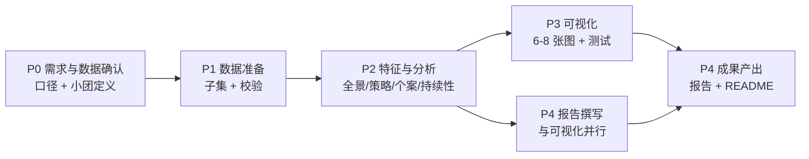

# 任务清单 · Task3 专题 S4「小代表团的大突破」

> 本文档为**规划与调度**文件，不含代码实现细节。状态随任务推进更新。
> 状态图例：`待办` / `进行中` / `已完成` / `阻塞`
> 产出目录：报告与测试记录在 `docs/Task3/`；数据表与图表在 `outputs/task3_s4/`

## 〇、任务定义

**专题 S4（赛题任务三候选方向之一）**：小代表团的大突破。

赛题原话给出的引子：「中国香港（HKG）：1996 年首金 → 2020 年 8 行奖牌的历史最佳 → 2024；
以及 TPE、SGP 等『小而精』的夺牌策略（聚焦个别优势项目 vs 全面上阵）」。

**核心问题**：一个参赛规模很小的代表团，靠什么在奖牌榜上取得超出体量的突破？
突破口是「集中押注少数优势项目」还是「全面铺开」？这种突破能否持续？

### 验收标准

| 维度 | 要求 |
|---|---|
| 数据基础 | 必须由本项目数据集现算，可一键复现，不引入外部数据 |
| 口径 | 沿用 Task1 双口径（运动员行 38,360 / 小项 17,901），主分析用小项口径并声明 |
| 分析深度 | 不止于罗列小国夺牌数；需给出机制解释与可检验的比较框架 |
| 反例处理 | 必须处理「小代表团」定义敏感性、单届爆发的偶然性、团体项目放大的干扰 |
| 可视化 | 静态图 + 与其他 Task 风格一致；口径脚注齐全 |
| 交付物 | 研究报告（Markdown）、分析代码、图表、数据表 |

### 已有可复用资产（不重复造）

| 资产 | 路径 | 用途 |
|---|---|---|
| 清洗主表 | `docs/Task1/olympics_clean.csv` | 运动员行级，含归一 Sport / 泛化标记 / 政权继承 |
| 小项口径奖牌表 | `docs/Task1/medal_event_level.csv` | 小项级奖牌，本专题的主数据源 |
| 代表团×届次汇总 | `docs/Task1/noc_year_summary.csv` | 双口径并列，含参赛人数 |
| 特征宽表 | `docs/Task1/features_noc_year.csv` | 含 medal_per_athlete、gold_share 等派生特征 |
| 口径说明书 | `docs/Task1/数据质量与口径说明书.md` | 口径定义与已知偏差 |
| 现有代码 | `backend/src/*.py` | cleaning / features / visualize 可复用其函数与绘图原语 |

---

## 一、任务分解

### 阶段 P0 · 需求与数据确认

| ID | 任务 | 状态 | 产出 | 验收 |
|---|---|---|---|---|
| P0-1 | 提取 S4 专题需求，明确研究问题与分析边界 | 已完成 | 本文档 | 研究问题可判定、口径已声明 |
| P0-2 | 确认数据来源（沿用项目数据集，不新增外部数据） | 已完成 | 用户确认 | 得到明确答复 |
| P0-3 | 复核「小代表团」的可操作定义 | 已完成 | 定义方案（多阈值敏感性） | 至少 3 档阈值并说明选择理由 |

> **数据来源已确认**：本地已有数据集，按任务流约定已向用户询问是否需要补充外部数据，
> 用户答复「不用了，项目已快完成」，故全程不引入外部数据参与计算。

---

### 阶段 P1 · 数据准备与清洗校验

| ID | 任务 | 状态 | 产出 | 验收 |
|---|---|---|---|---|
| P1-1 | 从 Task1 产物中抽取 S4 分析子集（小代表团 × 全部届次） | 已完成 | `s4_base.csv` | 行数与源表可对账 |
| P1-2 | 定义并计算「小代表团」标签（参赛人数阈值，多档） | 已完成 | `size_class` 字段 | 各档样本量合理，边界国家不唯一依赖单档 |
| P1-3 | 清洗校验：口径守恒、无静默丢行、与 Task1 数字交叉对账 | 已完成 | 校验记录 | 关键数字与 Task1 一致 |
| P1-4 | 处理已知陷阱：团体项目放大、混合队、政权继承、1906 届 | 已完成 | 处理规则表 | 每条规则有对应实现与影响说明 |

---

### 阶段 P2 · 特征工程与分析

| ID | 任务 | 状态 | 产出 | 验收 |
|---|---|---|---|---|
| P2-1 | 特征：参赛规模、奖牌效率（奖牌/运动员）、夺牌集中度（HHI 或 Top-1 项占比）、项目广度 | 已完成 | 特征表 | 每个指标有定义、单位、值域说明 |
| P2-2 | 分析 A · 小代表团的全景：规模分布、夺牌概率、历史变迁 | 已完成 | 结果表 + 解读 | 能用数字回答「多小的团能拿牌」 |
| P2-3 | 分析 B · 「小而精」vs「全面上阵」：两种策略的实证检验 | 已完成 | 结果表 + 解读 | 有分组对比与反例 |
| P2-4 | 分析 C · 个案深挖：HKG / TPE / SGP（赛题点名）+ 至少 3 个补充案例 | 已完成 | 个案表 + 叙事 | 每个案例有首金、最佳届、优势项目 |
| P2-5 | 分析 D · 突破的可持续性：首金之后发生了什么 | 已完成 | 结果表 + 解读 | 给出持续性度量而非个例感受 |
| P2-6 | 度量稳健性检查：换阈值、换口径，结论是否翻转 | 已完成 | 敏感性表 | 至少 3 项核心结论做敏感性检验 |

---

### 阶段 P3 · 数据可视化

| ID | 任务 | 状态 | 产出 | 验收 |
|---|---|---|---|---|
| P3-1 | 图表设计（图型、口径脚注、配色与已有 fig01–fig10 一致） | 已完成 | 图表清单 | 每图对应一个论点 |
| P3-2 | 静态图产出（预计 6–8 张 SVG） | 已完成 | `outputs/task3_s4/figures/*.svg` | 合法 XML、含口径声明 |
| P3-3 | 代码测试：一键跑通，产出可复现 | 已完成 | 测试记录 | 从 Task1 产物到全部图表零报错 |

---

### 阶段 P4 · 成果产出

| ID | 任务 | 状态 | 产出 | 验收 |
|---|---|---|---|---|
| P4-1 | 研究报告正文 | 已完成 | `docs/Task3/S4_小代表团的大突破.md` | 含摘要、口径、三类分析、个案、结论、局限 |
| P4-2 | 专题 README（如何复现本专题） | 已完成 | `docs/Task3/README.md` | 新机器按说明可复现 |
| P4-3 | 任务清单状态回填 | 已完成 | 本文档 | 与实际产物一致 |

---

## 二、分析设计要点（先想清楚再动手）

### 2.1 「小代表团」怎么定义

不能用绝对奖牌数定义（那就是循环论证：拿牌多所以不小）。
采用**参赛人数**作为体量指标，分档：

| 档位 | 参赛人数 | 说明 |
|---|---|---|
| 微型 | ≤ 10 | 极小团，常见于早期或小地区 |
| 小型 | 11–50 | 赛题点名的 HKG / SGP 大致落在此档或以下 |
| 中型 | 51–150 | 对照组 |
| 大型 | > 150 | 对照组 |

实际阈值以数据分布为准，最终在报告中给出分档依据与样本量。

### 2.2 「突破」怎么量化

| 指标 | 定义 | 回答什么 |
|---|---|---|
| 夺牌率 | 有奖牌的代表团届次 / 全部代表团届次 | 多小的团还能站上领奖台 |
| 奖牌效率 | 小项口径奖牌数 / 参赛人数 | 单位人力产出 |
| 夺牌集中度 | Top-1 运动大类占总奖牌比；HHI | 押注单一项目还是铺开 |
| 项目广度 | 夺牌的运动大类数 | 突破面有多宽 |
| 突破持续性 | 首金后 N 届的夺牌届次占比 | 是偶发还是稳定 |

### 2.3 已知陷阱与对策

| 陷阱 | 影响 | 对策 |
|---|---|---|
| 团体项目放大 | 一枚团体金牌带来大量运动员行，但小项口径只算 1 枚 | 主分析用小项口径；另做行口径对照说明差异 |
| 单届偶发 | 一个小国在某届靠一两位选手拿牌，容易被当成「崛起」 | 用「连续性」而非单届峰值判断 |
| 早期样本小 | 1896–1920 参赛国少、项目少，夺牌率天然高 | 分时代对比，或以 1980 年后为主样本 |
| 政权继承 | URS/EUN/RUS、FRG/GDR/GER 混算会污染 | 个案分析用原始 NOC，不做继承合并 |
| 阈值敏感 | 结论可能随「小代表团」阈值变化 | 多阈值敏感性检验 |
| 混合队 | 1900 年前后的跨国混合队归到原 NOC | 个案分析避开混合队届次或单独标注 |

---

## 三、依赖关系

---

## 四、变更记录

| 阶段 | 变更 |
|---|---|
| 初版 | 建立 S4 专题任务分解，明确研究问题、体量分档与「突破」的量化指标 |
| P3 补测 · 2026-11 | 补 `backend/src/task3_s4_share_trend.py`，为第七节「小团份额上升」补齐 5 阈值敏感性（≤10/25/50/100/150），并接入一键流程；结论由「中等，需补测」升级为「较稳」 |
| P4 收尾 · 2026-11 | 回填全部任务状态（20 项全部已完成）；README 表数 19→20、自检产物数 33→34；修正报告第十一节与 8.4 的自相矛盾；重跑全链路复核幂等（MD5 一致） |

---

## 五、收尾状态

- **全部阶段已完成**：P0 需求与数据确认、P1 数据准备与校验、P2 特征工程与分析、P3 可视化与代码测试、P4 报告与 README，无遗留待办。
- **产物自检通过**：4 个核心文件 + 20 张结果表 + 10 张图，共 34 个产物全部存在且非空（`task3_s4_run_all.py --check` 退出码 0）。
- **可复现**：全链路 `task3_s4_run_all.py` 一键跑通、退出码 0；连续两次运行 `s4_results.json` 的 MD5 均为 `3bcb995161c4`，结果完全一致。
- **口径守恒**：`s4_verification.json` 十项校验全部通过（小项口径 17,901 / 行口径 38,360 / 主表 252,565 行）。
- **尚未收口的只有一类**：文档与源码尚未发布到本机项目目录（见项目整体交付环节，不属于本专题内容缺口）。
